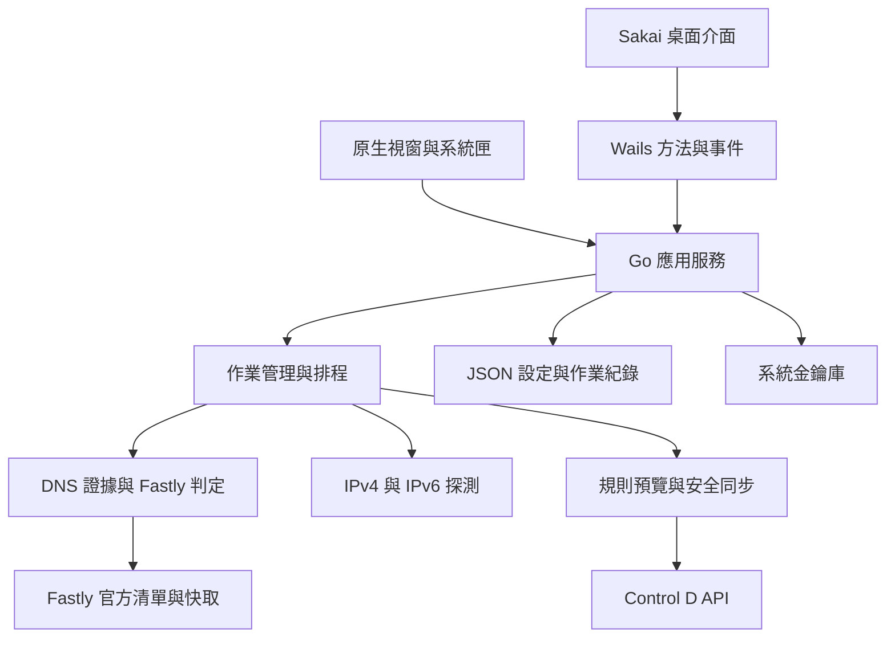
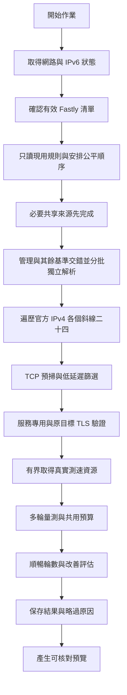

# 首版架構與介面設計

## 1. 設計原則

本文件記錄首版已實作的模組、資料模型、作業流程與介面設計，供後續維護使用，不是待開發的架構提案。Wails v3 Beta 負責原生視窗與系統匣，Sakai／Vue 負責顯示，Go 負責所有狀態、安全驗證、排程與外部 API。

功能與預設值以 [SPEC.md](../SPEC.md) 為準，傳輸格式與外部契約見 [API_SPEC.md](API_SPEC.md)。本文件描述實作，不代表完整桌面或外部服務已驗收；既有證據見 [TESTING.md](TESTING.md)，首版交付前的驗收 TODO 見 [PLAN.md](PLAN.md)，維護規則見 [MEMORY.md](MEMORY.md)。

不自建 localhost HTTP API 或 SSE。正式版的程式綁定／事件不對網路公開；Wails 開發時的前端工具鏈不代表產品提供 WebAPI。Node.js／Bun 只用於開發與建置。



固定版本：Wails `v3.0.0-beta.28`、PrimeVue `4.5.5`、`@primeuix/themes` `2.0.3`。直接使用 Sakai Vue `5.0.0`，固定提交 `ec6b6ef53ad4fa7f2861277f50f2d9e236c40372`；樣式採主儲存庫的固定 MIT 來源，與 v5 固定資產內容相同，不引入獨立 assets 子模組。前端自動檢查與原生目視驗收分開記錄。Wails CLI 必須與模組相同，不混用 v2 API。

## 2. 模組與目錄

主要結構如下；作業與排程實作集中在 internal/app，避免空模組與重複狀態。

```text
cmd/go-fastly-ctrld/       原生程式進入點
cmd/appicon/              同源 Windows ICO 產生工具
internal/app/             應用服務、作業、事件與排程
internal/appicon/         綠底白 F 的 PNG 與多尺寸 ICO
internal/domain/          領域資料與共同驗證
internal/fastly/          官方清單、快取與 CIDR 判斷
internal/dns/             Google／Cloudflare 雙 DoH 與獨立證據
internal/probe/           候選、HTTPS 量測、評分與預算
internal/controld/        帳號 API 與資料夾／規則轉換
internal/sync/            預覽、逐項寫入、回讀與復原
internal/network/         網路狀態、IPv6 與變動通知
internal/storage/         JSON 格式、互斥與安全替換
internal/secrets/         系統金鑰庫介面
internal/settings/        統一設定與網域修訂、自動授權失效
internal/desktop/         白名單綁定、系統匣、單一實例與登入時啟動
frontend/                 Sakai 版型、TypeScript、產生的綁定與資產嵌入
build/windows/            Windows 使用者權限與顯示縮放 manifest
scripts/                  兩平台建置、檢查、版本協調與授權生成工具
third_party/              第三方固定來源與法律原文
```

核心透過介面注入 DNS、HTTP、時鐘、網路監測、儲存與金鑰庫，避免測試依賴真實服務。平台特有功能由 Windows／Linux adapter 實作。Go 是設定與作業真實來源；前端不能自行決定哪些規則可寫入。

## 3. 本機資料模型

以下為實際 Go 型別的摘要；領域型別見 `internal/domain/models.go`，首次接管快照 `Origin` 見 `internal/sync/engine.go`。表格不是完整序列化欄位清單，傳輸契約另見 API_SPEC。

| 模型              | 重要內容                                                                                                         |
| ----------------- | ---------------------------------------------------------------------------------------------------------------- |
| `Settings`        | 設定預設版本、設定／憑證修訂、Profile、目的資料夾、探測／自動設定、游標、主題、登入時啟動及預設關閉的 forceWrite |
| `Automation`      | 啟用／只測試／共享授權、帳號／資料夾、逐域覆寫／移動授權、排程、預算及冷卻紀錄                                   |
| `DomainEntry`     | 穩定 ID、正規化 hostname、顯示名稱、啟用與同域測速 URL                                                           |
| `RangeSnapshot`   | 官方 CIDR、取得／刷新時間與內容摘要                                                                              |
| `DNSObservation`  | 個別來源、觀察時間、CNAME／A／AAAA 紀錄與錯誤                                                                    |
| `DetectionResult` | 網域、分類、觀察／相容時間欄位、各來源證據、候選與警告                                                           |
| `NetworkSnapshot` | 介面／路由／DNS／IPv6 狀態與正規化指紋                                                                           |
| `TestResult`      | 網域、位址族、候選／基準、樣本、成功率、速度／延遲、耗用 bytes、相容時間欄位與網路指紋                           |
| `SharedReference` | 同作業來源、策略、設定／網路／範圍摘要、來源樣本、成本與相容時間欄位                                             |
| `SyncPreview`     | ID、套用／復原種類、Profile、憑證／設定修訂、網路指紋、相容時間欄位與逐項預覽                                    |
| `PreviewItem`     | 操作、原值／預期值、原值摘要、結果 ID、forceWrite／originalDns 證據、可套用狀態與移動意圖                        |
| `Rule`            | 正規化動作／目標／資料夾／註解、可安全還原判定與可讀原始 JSON                                                    |
| `Origin`          | Profile、網域、首次接管前規則與擷取時間                                                                          |
| `JournalItem`     | 逐項預覽、API 接受證據、狀態、訊息及回讀後值                                                                     |
| `Job`             | 作業 ID／種類／狀態、進度／成本、取消請求、帳號、逐項 journal 與結果 ID                                          |

資料位置使用 OS 的使用者資料目錄，Windows 採 LocalAppData，Linux 區分 XDG 設定／資料／快取目錄。設定與網域統一保存在 `state.json`，確保同一修訂安全替換；另有 `fastly.json`、`detections/`、`tests/`、`snapshots/`、`jobs/`。data 目錄的 `history-hidden.json` 以版本化 envelope 保存已從執行紀錄列表移除的作業 ID，不修改 `jobs/` 的安全 journal。不硬編碼使用者名稱。

時間使用 UTC RFC 3339，UI 轉成當地時間。ID、修訂與摘要用字串，流量用明確的 bytes 整數。持久化與前端傳輸資料不得包含權杖。既有 `expiresAt` 等時間欄位僅供格式相容、快取刷新或歷史查閱，不以結果、共享參考或套用／復原預覽的年齡判定套用資格。

### 安全保存

1. 取得資料／作業互斥，驗證格式版本與新資料。
2. 寫入同目錄暫存檔、同步內容，使用平台安全替換。
3. 可支援的平台同步必要的目錄／中繼資料，再確認讀回。
4. 任一步驟失敗保留最後有效資料與錯誤，不先刪目的檔再重新命名。

未完成 journal、自動作業安全標記與首次接管快照不可被一般清理刪除。多檔案更新以 journal 記錄可恢復狀態，不把單檔安全替換誤當成多檔案交易。

執行紀錄刪除只更新列表索引：Core gate 內重驗可刪終態、未決項目與活動作業 ID，先安全保存完整索引，成功後才更新記憶體並送出 `jobs:changed`。快照與 ListJobs 過濾已移除項目；GetJob、復原與自動冷卻仍讀完整安全底帳。受保護作業即使被索引標記也要顯示，未知／損毀索引阻擋啟動且不覆寫。保存失敗保留舊索引與列表，不碰結果、錯誤、origin 或 checkpoint。

## 4. 測試流程與預算



作業擷取設定修訂與網路指紋；途中變動會取消剩餘探測並使結果不能自動套用。HTTP 連線固定至已驗證 IP，TLS 使用實際資源 hostname，並另外驗證原目標網域；正常驗證憑證。下載、DNS 與控制 API 使用不同 client，不能共用允許任意代理／重新導向的預設 transport。

DNS 每輪並行查詢 Google 與 Cloudflare 的 CNAME／A／AAAA，以 RFC 8484 DNS wire format over HTTPS 傳輸。證據依來源分開保存；兩方 Fastly 歸屬一致才允許自動評估，不要求位址相同。來源差異、單方失敗與非完整證據不能用系統 DNS 補成肯定結論；TTL 只決定刷新，不是資格門檻。

`Engine.RefreshDNS` 由 Core 注入雙 DoH；`evidence.go` 在 Finish 取得下載槽後／整理連線前實查，三輪後依 TTL 需要再查。核對網域、兩方完整性及原分類，IP 正常輪替不視為分類改變，mixed 不擴權。失敗保診斷與流量、清建議，依實際原因分類。`Prepared.Detection` 回傳最後實取證據，pipeline 在 Finish 後保存，不偽造時間；零 TTL 與資料年齡不阻擋完成或套用。

`fastly.Valid` 只驗公開 CIDR 與摘要。Client.Get 以 24 小時作刷新間隔，刷新成功採新內容；暫時失敗可沿用結構合法快取，但取消、保存失敗或無合法內容仍失敗。結果、共享與 apply／restore 預覽保留既有時間欄位供相容查閱，所有套用資格不讀年齡。CleanExpiredCaches 只清 Fastly／DNS 刷新快取，不刪結果、參考或預覽；真實身分、策略、設定、網路、原值與 TLS 驗證照常執行。

共用下載計數器在讀取前保留額度；Limit 0 不限但仍累計實際 bytes，非零才裁預算。JobSeconds 0 不設整作業 deadline，非零套父 context。socket 由 idleConn 每次 Read／Write 重設十秒期限並受更早父 deadline 限制，取消會關閉連線，不將活躍下載誤作整請求十秒。

近端預掃 64 個 worker／一秒 TCP，12 域在同作業共用 .133 結果，session 在 releaseTester 前結束；沒有固定六十秒總限制。服務資格 16 個 worker、三次三秒 TCP 及三秒 HTTPS。完整模式略過輕掃，48 個一次初驗後 16 個三次複測，不加近端六十毫秒濾網。每批最多四域並行 Prepare；Engine.Fork 共用預掃及全域槽、各自回報進度，所有域合計不超各階段上限，完整複測也占服務槽。每域 TLS／POP 保持獨立。Finish 依任務順序串行下載，下載槽為全作業一個。I/O 與 worker 採假 TCP／net.Pipe 驗證，不當成真網路效能結論。

基準與候選採相同資源、時窗與取樣策略，IPv4／IPv6 分開排名。已測失敗速度以零值參與中位數；未測樣本不冒充已失敗或已成功。順暢門檻為該族最快樣本的 30%，至少 3 Mbps；排序順暢次數、速度中位、TCP 中位。依參考 v0.8.3，下載建議須比最好現用基準多順暢輪數，不加額外 20% 及三成功要求；延遲需低超過 10 ms。預算達限標未完成；ManagedCompleted／BaselinesCompleted 分別記處理數，游標不從 Completed 硬扣固定數量，無管理網域時才按基準輪替。

`internal/probe/profile.go` 定義內建服務探測，`scan.go` 由各 /24 探索池預掃，`resources.go` 有界發現 Twitch JS 與 GitHub Release 簽章。原目標、probe 與下載 hostname 分開記錄；同 /24 尾碼轉換只用於官方 IPv4，IPv6 不類推。資源取得也使用共用 body 預算、正常 TLS 與公開固定 IP；GitHub 跳轉只接受指定 Release 路徑與 GitHubusercontent 網域，最多五跳，不把下載 client 改成任意重新導向。

策略版本為 10。官方 IPv4 完整逐 /24 探索並去重，不截 4,096 池或每 CIDR 2,048 取樣。TLS 合格後才取低延遲前十，官方池內的現用基準也計前十，池外或未入選的基準額外保留；失敗進 `rejected` 不占名額。策略版本不符的結果只供展示，重測後才能套用；基準與未完成結果也不能套用。UI 按實際管理資源分組，基準顯示服務、探測網域與測試方式，另列管理域、自訂檔及淘汰診斷；候選列自身機房或未知，推薦排前並明示標籤，逐輪明細用官方 Fieldset／DataTable。

下載速度使用單一量測槽，每輪維持相同候選順序，不輪替起點；三輪使用同輪共用資源，GitHub 每輪更新簽章。任一輪資源探索失敗會清除全部下載評分，回資格階段 TCP 中位數及一次 HTTPS 驗證，已讀 bytes 照計；取消、總期限及預算不足仍為未完成、不建議。無資源一般域預設只用資格延遲，不額外假做三輪下載。連線探測使用獨立的受限並行池。

### 獨立基準與選用共享參考

`SelectedBaselines` 從 `ProbeSettings.services` 選服務，缺值預設 GitHub／Twitch／X，非 nil 空陣列代表全關；每組展開全部網域，共 GitHub 2／Twitch 6／X 4 域，清單與使用者 README 一致。`baseline-twitch-jtvnw` 對應 jtvnw.twitchcdn.net，預設僅自身連線，依自身 DNS 尾碼探索；baseline-github／baseline-twitch／baseline-x 分別對應三個下載域。`internal/app/test_pipeline.go` 先安排 shared 必要兩來源，建立本輪參考後，其餘管理域與輪替後基準交錯，每批最多四域資格、依序 Finish，避免基準獨占有限額度。空管理清單／無權杖仍可測基準，不自動新增管理域或規則。

同作業去重只限同 Host、無自訂檔、無獨立現用規則且非共享目標；複製原始資格與樣本後分別標基準／管理，ReusedFrom 記來源結果 ID、Bytes 為零，不清管理資格。獨立現用規則保精確 IP 比較，不受基準去重影響；來源或 DNS 不因時間經過完整重測。實際設定／網路／驗證變化仍失效，自動套用只評估本作業 ResultIDs 中完整管理結果。工作量估計不假設去重，保現用基準餘量，不含協定開銷，也不是精準時間承諾。

管理域分流依序為明確同域自訂檔、三個內建下載域、無檔管理域選用共享參考、其他自身連線。下載域為 release-assets.githubusercontent.com／assets.twitch.tv／pbs.twimg.com；其餘九域預設不下載或借分。X 固定使用 <https://pbs.twimg.com/media/HU2En5YbAAAByoT?format=png&name=900x900>，短檔不代表持續大檔頻寬。一般域預設 latency，IPv6 另需 `enableIpv6` 與網路可用雙條件。候選在生成時轉官方 IPv4 服務尾碼，系統／現用 Control D 基準一律保精確位址，資格與下載均直接量該 IP。每域探自己的 Host／SNI，POP 只取自身回應，不以 k.twitchcdn.net 代表其他 Twitch 域；無法辨識即未知。

只有 shared 模式才由本輪 GitHub／Twitch 組並保存參考；`reference.go` 以 IPv4 /24 或完整 IPv6 映射管理網域真實 DNS 位址，再驗自身 TLS。IPv6 只用實際已知位址，不猜尾碼。

所有下載統一 8 MiB，累積 256 KiB 後檢查兩秒；不另設 64 KiB 最小量，但必須 2xx 且非空，3xx 本文不當成功、不跟隨下載轉址，截斷或讀取錯誤不能成功。ElapsedMilliseconds 記完整請求含失敗；Mbps 維持本文計時，不把短圖瞬間讀取當持續頻寬。取消、逐次 I/O timeout 與自訂作業上限有效，預設不限。參考只重用本作業實測，references 供最後 ID／摘要／來源核對，不跨作業代測。來源成本在 Job 計一次，samples 與 referenceScores 分開；HTTP／I/O 逾時、探索白名單與取消不放寬。

候選須對每個來源的現用基準完整可比，至少一個來源順暢增加、其餘不退；不混合原始 Mbps，排序使用共同順暢與各自基準相對值。失敗／分歧／預算不足／基準未涵蓋回到自己的延遲。共享推薦綁獨立自動權限，預覽與最後寫入重驗 cache 證據及目標 TLS／HTTP，適用相同的安全 journal／取消／metadata checkpoint 防護。

### 參考來源與本案設計分類

以下「本案設計」不是宣稱全球首創；Sakai／Wails／Vue／PrimeVue 等框架及法律原文也不是本案原創。

| 分類         | 部分                                                                                                                                                                                                                            |
| ------------ | ------------------------------------------------------------------------------------------------------------------------------------------------------------------------------------------------------------------------------- |
| 沿用參考概念 | 官方 IP API、/24 低延遲預掃、服務 probe 路徑與尾碼、動態資源、固定 IP 與正常 TLS、三輪／系統基準、順暢門檻與失敗零值                                                                                                            |
| 參考概念適配 | 有效範圍快取、可選總期限與全作業下載預算、受限 metadata 跳轉與有界首頁備援；12 域各自驗證 Host／TLS／POP，三域下載，X 使用指定 PNG、不借 GitHub；非空 2xx 才計下載成功                                                          |
| 本案自行設計 | Go／Wails 整合、Google＋Cloudflare 並行證據、選用 IPv6 與共享 batch/cache/摘要/同 IP IPv6/獨立授權、Control D 預覽／journal／復原、獨立無帳號基準、公平任務與安全同作業重用、持久安全標記、JSON／金鑰庫、業務 UI 與同源四檔交付 |

參考 v0.8.3 固定提交與 MIT 原文見 [THIRD_PARTY_NOTICES.md](THIRD_PARTY_NOTICES.md)。只以 AST 擷取原 rank／evaluate 對固定輸入重播，未執行主程式、設定或 hosts；八案例保存為 Go 回歸資料，驗分數與建議一致。

## 5. 同步與復原狀態機

### 作業狀態

`queued` → `running` → `completed`／`partial`／`failed`／`cancelled`／`needs_recovery`。

`completed` 表示所有預定項目都有可判斷結果，不代表每個網域都套用；無改善等正常略過另列計數。`partial` 表示有成功與失敗／待處理項目；遠端結果不確定不能以 `failed` 暗示沒有變更。

### 單項同步

1. 檢查預覽存在與種類、設定／權杖修訂、網路、授權與測試結果，不看時間經過。
   所有新選定 IPv4／IPv6 均以自身 Host／SNI 對精確 IP 重驗正常 TLS／HTTPS，再核取消、網路、設定與範圍內容；保留的原 CNAME 不當成 IP，原始 DNS 回填仍走完整原鏈驗證。任何實際驗證失敗皆在寫入前停止。
2. 回讀原規則與資料夾語意，比較預覽的前值摘要。
3. 保存原值、預期後值與 `prepared` journal，持久化成功才可送出。
4. 保存 `write_started`，送出單項 POST／PUT。
5. API 明確成功立即持久化 `writeAccepted`，再回讀比較，記錄 `verified`、`conflict`、`failed`、`unconfirmed` 或 `unknown`。
6. 逾時／崩潰後先回讀再決定，不直接重送；`unknown` 進入待復原。

同值前後像不能證明 API 曾接受。只有持久化 `writeAccepted` 加回讀一致才可 verified；缺證據而同值時終結為 unconfirmed，說明「無法確認曾寫入」、不提供復原、不盲重送。有接受證據但保存／回讀故障先 needs_recovery，重開只核對；journal 缺欄位視為無接受證據。驗證或快照期間時間經過不使預覽失效。

### 無改善時的原始 DNS 回填

`forceWrite` 關閉時只套用有改善的候選，其餘略過；開啟只在完整結果沒有最佳候選時啟用回填，不修改正常改善選擇器。有改善仍用最佳 IP；相同目標以 rewrite 操作實際送出。

預覽即時向固定雙 DoH 取得證據，`internal/dns/original.go` 驗網域／ID／完整 confirmed、兩個獨立來源、最多八跳且無循環的鏈結、公開官方位址與鏈尾 owner，不以時間或 TTL 拒絕。優先兩方相同的第一跳 CNAME，否則使用原始 IPv4；明選 IPv6 才加入原始 AAAA。CNAME 分歧、自己或子域及其他有效 Profile 規則涵蓋目標均阻擋，整批預期規則也交叉核對。

`PreviewItem.originalDns` 綁定私有不可變更預覽與結果，不使用未綁定 cache 或現有 Control D 覆寫。預覽與套用前用原 hostname／SNI 對精確原始 IP 做正常 TLS／HTTPS 驗證，不轉服務尾碼、不下載測速檔。套用前重查雙來源、重驗真實 After 目標，最後回讀 Profile 時再查跨規則涵蓋；無法確認就不寫。復原只用已 verified 的原始快照，不走此回填分支。

Profile 寫入全程序列化，不把多個不同行為的網域塞進同一批寫入來犧牲逐項核對。若 API 未提供條件式寫入，仍存在最後回讀與送出間的競爭窗口，須在 UI 提醒，不能承諾跨客戶端互斥。

規則快照按 action.do 判定 IPv6 適用性：do=2 必須明確字串 via_v6，do=0／1／3 可省略或明確空字串，還原表單不送不適用欄位。非 do=2 的非空 IPv6、null／型別錯誤、未知欄位及缺少明確 comment 仍不可安全覆寫。原 JSON 與摘要仍用於備份、衝突與復原，不盲送未知欄位。略過項目不顯示刪除，也不因強制模式附上可手動繞過的誤導文字。

### 復原

- 使用指定作業的逐項快照，先產生復原預覽。
- 現值仍等於已核對後值才可恢復前值／刪除當時新增項目。
- 後續工具作業或其他客戶端已改動時標記衝突，不能直接跳回首次原值。
- 多次工具變更需按歷史核對復原；首次接管原值另保留，避免遺失接管前設定。
- 同樣先 journal、再寫入、再回讀；取消只能在單項安全邊界停止。
- 原始 JSON 是稽核備份，不代表所有未文件化欄位都可重新送回 API。

## 6. 排程與原生桌面

排程由 Go 執行，不依賴 Vue timer。網路監測正規化介面、預設路由、DNS 與 IPv6 狀態後產生指紋；事件合併等待穩定，只排一次最新狀態。測試與同步均防重入，手動操作不啟動第二條背景寫入序列。

冷卻以同網域最後成功變更時間判斷，IPv4／IPv6 共用此網域冷卻。重建歷史時限定目前 Profile 與權杖修訂，不沿用另一個帳號的時間。現用路線反覆失敗的例外切換也需留下理由。暫停自動與更換 Profile 使待執行自動作業失效，不撤銷已有規則。

強制寫入只略過冷卻，不略過排程／穩定等待、單一作業及覆寫／移動／共享授權；testOnly 仍不套用。開關保存為 optional patch，省略保留原值；變更時旋轉修訂、停自動清 grants，防止沿用只允許改善時的舊授權。

自動測試／寫入前在資料目錄保存 `automation-checkpoint.json`；排程、游標與冷卻紀錄皆完成後才清除阻擋狀態。失敗時保留標記、停止後續自動作業，快照回報實際暫停與原因；已回讀確認的帳號變更仍保留成功後像。重新開啟不自行恢復，明確重新授權前依相同帳號的 verified journal 重建冷卻。暫停世代序號防止舊完成事件清除新故障；資料區也無法保存時明確提示先修復再退出。

暫停會取消純測試，已送出的遠端寫入先核對或保存未決紀錄，再停止於安全項目邊界。Profile／權杖更換或刪除須等待這個邊界，進行中的作業不能改用另一個帳號或 Profile。

啟動流程先建立單一實例，再讀設定、驗證金鑰庫／桌面能力、檢查未完 journal，最後啟動排程。登入時啟動設定透過平台 adapter 管理使用者層級啟動項，不要求管理員、不建立 OS 服務；OS 操作失敗不能顯示開關已成功啟用。

視窗關閉同步 hook 只 cancel 預設關閉，再以原子 cached tray 狀態 Hide／Minimise，不等 Core gate／API，也不以 PositionWindow 移動主窗探測。Windows 限自身 HWND_MESSAGE／PID／uid1，以 UFlags=0 的 NIM_MODIFY 核對既有圖示，不新增／刪除或改圖示、提示、可見性及版本；不依賴只取座標的 Shell_NotifyIconGetRect，因此溢位區不必展開。Linux 核自身 DBus 註冊，不只看桌面宿主存在。還原先 UnMinimise／Show／Focus；真正退出才安全等 journal。

`trayMonitor` 由前端就緒後的單一背景迴圈擁有，每五秒處理已確認／未確認／未註冊證據。前兩次失敗保最近確認值；啟動未確認時保工作列退路。第三次失敗停用隱藏並還原不可見視窗至工作列，記一次 TRAY_UNCONFIRMED；連續三次明確未註冊才記 TRAY_UNAVAILABLE。確認成功立即重設計數與通知節流；一般恢復不自動隱藏主窗，背景登入僅在初始確認成功時隱藏。狀態先存 atomic，再更新可能等待 Core gate 的 UI 快照；關閉 hook 不參與查詢或等待。隔離監測不取代真實桌面中斷與還原驗收。

`internal/appicon` 以綠底白 F 像素圖樣產生 PNG 與 16／32／48／64／128／256 ICO，系統匣和 application.Options.Icon 共用來源。Windows 腳本以固定 Wails CLI 嵌入 ID 3 圖示與 asInvoker／PerMonitorV2 manifest；主視窗可讀資源或同源 PNG。資源原子拒覆寫，僅清當次暫存，不留下 syso 干擾後續建置，不需額外 Runtime 或專案依賴。

## 7. Sakai 介面

### 版型、固定來源與授權

直接使用 Sakai 官方 AppLayout、AppTopbar、AppSidebar、AppMenu、AppMenuItem、AppFooter 及 useLayout 布局狀態，將八個業務頁面接入官方主內容區；不以自組 PrimeVue Toolbar／Menu／Drawer 代替。布局元件由固定官方來源轉為 TypeScript，只適配選單、路由、品牌、Wails 主題保存、版本資訊與必要無障礙整合；保留官方布局 class、遞迴選單與響應式行為。展示頁、假登入、設定器及沒有產品功能的示範按鈕不帶入。業務頁使用 PrimeVue 官方元件與 MIT Aura，Go 綁定為介面型別來源。

布局採用 Sakai Vue 5.0.0、提交 `ec6b6ef53ad4fa7f2861277f50f2d9e236c40372`，保留根目錄 MIT 及 PrimeTek 著作權。十四個布局 SCSS 與官方 Tailwind 設定沿用主儲存庫 4.3.0 歷史提交 `7c32ae1f6fc75e18a5e735f76e1ab25d1167d26c` 的 MIT 原文，已與 v5 所固定的 sakai-assets 提交 `eaa70ece4cfa9aeb8f60b36dce5a422b6bae8003` 核對，十五份樣式的 Git blob 全部相同。`sakai-source.json` 分別記錄布局與樣式來源、雜湊、資產對照及七個必要適配，離線測試驗證十六份未修改檔案。這不是自行重寫樣式的例外；不引入獨立子模組，也不推定其其他內容的授權。關於頁與合併授權由同一清單產生布局版本及樣式來源說明，保留原始法律文字；見 THIRD_PARTY_NOTICES 及 third_party/sakai-vue/LICENSE.md。

### 導覽與無障礙

導覽沿用 Sakai v5 遞迴 AppMenuItem 的 fullPath／parentPath、activePath、根群組 hover 與穩定 key；RouterLink 使用官方 exactActiveClass，保留 active-route／aria-current 及原生 Tab／Enter，不改造成 PrimeVue Menu。停用項目在事件擷取階段阻止路由導覽，支援 PrimeVue 的布林值或函式形式。頂欄原生按鈕及側欄／遮罩 class 直接沿用官方，不另造 Drawer。

布局狀態以 staticMenuInactive／mobileMenuActive 分流桌面 static、桌面 overlay 與行動選單，切換模式清理舊狀態，不互相誤切。側欄擁有路由及外點監聽，行動路由寫入 activePath，桌面路由清空；查詢參數導覽也關閉選單並清 hover。窄視窗以官方 PrimeVue FocusTrap 補足焦點循環，整合開啟聚焦、Escape／外點關閉、關閉返回及 blocked-scroll 清理；收起側欄使用 inert，避免離屏選單仍可被 Tab 聚焦。依官方 991／992 像素切換，跨斷點關閉舊選單，同側桌面縮放不誤關 overlay；卸載清除 resize／click／keydown 監聽，只在跨斷點重掛 FocusTrap。卡片、通知及詳情 Dialog 維持官方控制項與響應式尺寸。

### 樣式與字型

入口直接載入官方 `assets/tailwind.css` 與 `assets/layout/layout.scss`，使用官方 Lato 字型、PrimeUI Tailwind 外掛及 992 像素 lg 斷點。原始布局 SCSS 排除自動排版，避免改寫官方來源；包含官方自身的元件選擇器，不誤當成本案新增覆寫。`style.css` 僅補瀏覽器色系及減少動態偏好，業務排列、間距與換行用工具類別；不另寫布局／卡片／選取外觀，也不全域覆寫按鈕或焦點。Sass 與 Node 型別只供建置／測試，不安裝或升級 Runtime。

路由使用 hash 模式，避免桌面資產載入與深層路由衝突。預設字型、圖示、CSS／JS 與必要資產隨程式打包；使用者可選電腦既有字型，不下載或匯入檔案。不在 WebView 載入外部程式碼或文件；外部連結經驗證後由系統瀏覽器開啟。

字型偏好由 `shared/fonts.ts` 管理：官方 Select 的 show 事件同步呼叫 `window.queryLocalFonts()`，每次開啟更新，以 family 去重排序、官方 loading／filter 呈現。只讀 metadata、不呼 blob、不經 Go；API／權限／安全來源錯誤各給短訊息並保留目前字型，舊非同步回應不能覆新清單。啟動只還原 `localStorage` 的 `fastly-ctrld.fontFamily`；選擇先保存成功再改 body 的 font-family，預設刪 inline 值回官方 Lato／系統後備。不改 Sakai SCSS、PrimeIcons 或等寬字型，不旋轉 Settings.Revision；保存失敗時還原選單顯示，預覽與實際字型一致。WebView2／WebKit 能力與權限仍需原生驗收。

### 頁面與操作契約

| 頁面           | 設計重點                                                                                                |
| -------------- | ------------------------------------------------------------------------------------------------------- |
| 總覽           | 唯一偵測／測速／取消入口、near／full、進度與三類結果；空域也測基準                                      |
| 網域管理       | 網域或完整 HTTPS URL 匯入、資源衝突確認、啟用／編輯／DNS 證據                                           |
| 測速結果       | 僅結果、候選／淘汰詳情與單筆／全部清除，不重複啟動                                                      |
| 規則同步       | Profile → 一般資料夾 → 規則，獨立新增資料夾、不可變更差異／確認                                         |
| 執行紀錄       | 作業明細、部分失敗、待核對、復原預覽與衝突，單筆刪除／清除已結束列表紀錄並保護安全底帳                  |
| 設定           | 權杖、強制寫入確認、自動模式／頻率、授權 Dialog、外觀／登入；進階可選基準、擴充及上限，原版核心數值固定 |
| 錯誤紀錄       | 搜尋／刪除／清空、同 ID 高亮定位、詳細浮動 Dialog／複製                                                 |
| 關於與開源授權 | 版本／提交、元件搜尋、完整離線法律原文及系統瀏覽器來源按鈕                                              |

以下為首版介面必須維持的互動契約：

- 套用按鈕只能引用有效 `previewId`，不能直接由畫面組合任意規則寫入。
- 覆寫、資料夾移動與子網域影響都以文字提示，不只用顏色。
- 權杖輸入提交後立即清空，不回填明文；保存狀態區別已保存、未保存、無法讀取。
- 長作業立即回傳 ID，由事件與快照更新進度；UI 不顯示假百分比。
- 總覽開始／停止為同一顆純圖示 Button，待機 play、啟動等待、執行 stop、停止等待；取得 ID 即可停止，不因快照刷新或全域 busy 鎖死。停止直到 Go 確認結束才恢復。全域 JobStatus 使用官方可摺疊 Panel／Tag／不定進度列，預設收合，只保留作業名稱／狀態；展開顯示階段、網域、耗時、流量與詳細訊息。Panel 位於 RouterView 外，以元件狀態保留本次手動選擇，切頁及作業開始／結束不強制改變，重啟回收合；保留官方切換按鈕、Enter／Space 與 ARIA，不自造控制項。自動啟用不冒稱正在作業。
- 前端重新載入仍能恢復 Go 作業；事件不是永久紀錄，也不是唯一真實來源。
- 明確區別 `partial`、`needs_recovery` 與真正完成。API 回讀確認帳號保存狀態，不能證明裝置 DNS 已生效；此限制集中於操作文件，不在頁尾、作業面板或執行紀錄重複提示，實際安全回讀與核對仍須執行。
- 流量設定提供常用值與自訂 bytes 換算，操作前顯示整批上限與額外協定流量說明。
- `testOnly` 自動模式不需帳號且不套用；可測三組共 12 域基準及啟用管理域，切回套用模式仍重新核完整授權。基準結果不會因有最佳 IP 就變成管理項。
- 所有產品文案採臺灣正體中文，支援鍵盤操作、焦點管理、載入／空白／錯誤狀態。
- `IconButton` 只組合 PrimeVue Button 與官方 Tooltip 的 hover／focus 行為，外部 id／ARIA 屬性傳至真正的 Button，不自製座標或 Teleport；危險確認內容保留。`Notifications` 是官方 Toast 的業務 adapter，於 mounted 後同步訊息，保留 errorId／去重計次；必要內容插槽呈現 PrimeIcons 狀態圖示，導覽使用官方 Button，容器、關閉、動畫與 success life 由官方負責。替換訊息須防 remove 的 close 回呼誤刪新通知。
- 全域 ToastService／ConfirmationService 配合 Sakai，操作確認用官方 ConfirmDialog，預設焦點取消；adapter 只把結果轉 Promise，切頁或另一確認取代時安全取消。沒有 `window.confirm`、自製通知動畫或提示定位 CSS。
- 表單統一官方 Select／InputNumber／InputText／Textarea／Checkbox，進階與淘汰診斷用 Fieldset，法律清單用 Accordion／AccordionPanel／AccordionHeader／AccordionContent。標題只填官方 Header 文字區，不取代官方按鈕、箭頭、ARIA 或鍵盤處理；multiple 與 value 模型保存展開狀態，長名稱與版本以工具類別換行、留間距。勾選項採 flex／items-center／gap，Checkbox inputId 與獨立 label for 配對；包住 Select／InputNumber 的欄位標籤明確直排。不另寫元件 CSS 或覆寫官方內部 class，保留必要業務組合；既有文件或實作不是自訂樣式的豁免理由。
- 錯誤列以 DataTable 官方單選、highlightOnSelect 與 row-select 開詳情，保留 errorId 分頁定位、ARIA 及鍵盤選取。列選取與 Dialog 資料分開，關閉時同步清除，避免自動重開；不自行畫選取外框。
- 執行紀錄列用官方圖示按鈕單筆刪除，頁首清除全部；沿用 ConfirmDialog 且預設取消。單筆對進行中／待核對／有未決項目與活動槽作業停用，真正限制由 Go 重驗。全清不因其他作業／recovery 停用，只清可刪項目並提示保留數；成功刷新快照後同步關閉已刪明細、取消讀取與清除復原預覽，全域面板自然切到最近可見作業或消失。
- 唯讀流程使用 `useReadScope` 的區域 loading／phase，不設全域 busy；切夾、取消或卸載會取消原始 SDK Promise，generation 阻止舊資料與通知覆蓋。Go 接 Wails context 傳 HTTP，不能只在 JavaScript 丟掉回應。
- 同步頁 Profile／folders／rules 放本頁資料；清單只呼叫目的資料夾端點，不讀其他夾。預覽／每項寫前另保完整 Profile 核對與移動授權，配置選擇快取不代替這些安全檢查。
- 一般 `refresh` 共用 singleflight，避免輪詢／事件重疊複製所有結果；寫入後 refresh 等舊請求結束再讀新快照，舊請求失敗也不阻止更新。純讀不連帶重刷快照與金鑰庫，配置保存／真正寫入仍保安全 run。
- `internal/errorlog` 在私人 data/errors.json 保存最多 200 筆，同錯誤短時合併；`error:recorded` 與 Bridge ErrorID 指向同筆。獨立 mutex、不取得 Core gate，避免在錯誤處理造成死鎖；未知紀錄不覆寫。
- `management.go` 處理資料夾、私有匯入衝突選擇及 typed 結果刪除；所有變更守原 writer／recovery 防護，清結果不刪 undo。
- `PresetVersion=2`／策略 10 在設定層核對固定參數；格式正規化須保留 scanMode、已保存的非零流量／期限及規則／journal，不隱含擴權。固定參數變更時旋轉修訂、停自動並清 grants，不支援的 preset 保檔拒讀；各格式條件見 [API_SPEC.md](API_SPEC.md)。相容性改善欄位不參與評分。

## 8. 安全邊界與測試設計

- Wails 只載入內建可信資產；沒有 HTTP API 仍須驗證所有綁定參數與授權。
- 權杖由 Go 金鑰庫 adapter 管理，不提供明文查詢、不進診斷匯出。
- 測試下載限制公開 IP、官方範圍候選、同 hostname、合法埠與重新導向。
- DoH 固定 Google／Cloudflare 公開端點，不接受任意解析服務 URL，也不得被當成可任意探測內網的候選。
- 快照與日誌存在使用者私人目錄，匯出前遮蔽敏感資料並提醒網域清單的隱私。
- 金鑰庫、檔案、HTTP 與時鐘故障均可注入測試；跨平台行為需在實際 OS 驗收。
- 以模擬 DNS／TLS／Control D 驗證主要流程；真實 API 僅在另行授權的隔離 Profile 測試。
- Windows 原生隔離驗證包含 IPC、註冊確認與關閉還原；持續監測需至少四次、約十五秒且無失敗，不能以快速啟動代替。溢位區手動開關、Explorer 重啟與完整跨平台互動仍另驗；所有未知契約保留在 [PLAN.md](PLAN.md)，精確測試範圍見 [TESTING.md](TESTING.md)。

## 9. 打包設計

`scripts/frontend.mjs` 集中跨平台前端命令：驗 Node.js 下限與固定 Bun 1.4.2，不自動安裝或升級；安裝使用唯一 `frontend/bun.lock` 與 frozen／ignore-scripts／hoisted，腳本交由 Bun 啟動。`typecheck`／`build` 的 vue-tsc 由目前 Node 執行檔啟動，若強制以 Bun 執行此入口即拒絕，避免 Bun 的 CommonJS 讀取路徑略過 Volar 的 Vue 注入。保留原 tsconfig、嚴格檢查及所有前置法律生成，不加萬用宣告、不改第三方套件、不換 Vite bundler 或測試執行池。法律與發布工具仍用 Node；依賴版本及法律原文不變。

根目錄 Prettier／ESLint 僅允許明確工具名稱，由 Node 直接呼叫套件 CLI 並以 repo 根目錄工作，不依賴 npm 的 Windows `.cmd` 捷徑；其他前端命令仍以 frontend 為工作目錄。這使 npm／Bun 的不同捷徑格式不會漏掉根目錄檢查。

`scripts/version.mjs` 驗證臺灣日、閏年及版本格式；一般打包只讀根目錄 `VERSION`。只有明確要求執行 `release.mjs --bump` 才原子更新版本檔：同日第三碼加一、新日首次為一、日期倒退拒絕。升版與打包共用排他鎖，有 pending 交易先恢復；升版後提交再打包。`release.mjs` 協調原生 worker，`archive.mjs` 只讀核對 ZIP／TAR 四檔，不新增套件依賴。Node 與 Go 開發版本為 development，正式版由版本檔同源注入 Go 與內嵌 manifest。

Git common 目錄下 `fastly-releases` 保存 releases.json、wx 排他鎖與每交易獨立 work 暫存，不進 Git。交易為 building → 已驗證 ready → `dist/builds/{交易識別碼}` 複製 → 成功紀錄；同版每次獨立保存，換提交或跨日也不改版。失敗保留暫存，ready 比對 SHA 後續傳、不重建。寫紀錄採同目錄暫存／sync／rename，不先刪原檔；鎖只由原 owner 解除、不搶殘留鎖。正式 worker 核 token、乾淨來源提交、平台、已提交 VERSION 與暫存路徑。

schema 2 的 `releases` 無損保留 schema 1 成功紀錄；`builds` 每次記識別碼、版本、revision、平台、開始時間與四檔／壓縮檔摘要，同版可記錄多個 revision。schema 1 的 ready 交易按保存的原 dist 路徑恢復，未知 schema 不覆寫。跨 clone／主機須同步 VERSION 與紀錄、避免各自併發；此紀錄不同於應用規則 journal，不會觸發帳號寫入。

兩平台在各自原生 x86_64 環境建置，前端資產嵌入 Go 執行檔；正式版使用 Wails `production` 標籤、不開 DevTools。壓縮檔只含執行檔、使用者 README、LICENSE 與 THIRD_PARTY_NOTICES.txt。開發文件留在 repo；版本、提交、未提交狀態與工具版本併入使用說明，SHA-256 在壓縮檔外。

授權工具只收集實際 Go 套件的模組／父目錄法律檔、前端執行依賴閉包與使用的字型／Tailwind。缺授權會中止，不假造通用 MIT；npm 缺漏的 Wails Runtime 原文使用同版 Go 模組，Vue devtools API 原文固定保存於 third_party。法律原文不翻譯。

Bun hoisted 可能保留同名同版的多個實體副本。每個實體路徑仍完整走訪依賴；收集後僅合併名稱、版本、來源、授權及每份法律檔名稱／原文／摘要全部相同的元件。相同 ID 資料不同即拒絕，不以跳過副本來漏收依賴，也不放寬 `validateData` 的重複 ID 檢查。

前端建置前生成 `frontend/generated/about.json`：元件含名稱、版本、授權類型、安全 HTTPS 來源與逐檔原文／SHA-256，另含本案、Sakai 與上游策略參考授權。資料不提交、無本機路徑，懶載入的關於頁靜態匯入它，不使用遠端 fetch、v-html 或任意檔案讀取。生成器允許首次缺少 frontend dist 的特定嵌入錯誤以解除循環，其他依賴錯誤停止。

Go 編譯後的 `--release` 不重新收集資料，直接以已內嵌的相同 manifest 合併完整法律原文與產生使用說明，核對版本／來源修訂；不產出多檔授權目錄或額外 build-info。已有套件檔案拒覆寫，部分失敗不產出壓縮檔。

`scripts/licenses.mjs` 的 `usage` 統一產生兩平台使用者 README，依平台顯示執行檔與最低需求，不複製根目錄開發 README。共用內容以 GitHub／Twitch／X 英文服務名稱標示三組共十二個範例及逐行匯入說明；GitHub 為 `raw.githubusercontent.com` 與 `release-assets.githubusercontent.com`，Twitch 六域包含 jtvnw.twitchcdn.net、X 四域。標題在程式碼區塊外，區塊只含網域，不變更匯入解析器或預設管理清單；另以說明段列全部 12 域各自探測、三個下載域及 X 完整固定 URL／不借 GitHub／短圖限制。範例不代表當次 Fastly 判定或自動寫入授權，仍需偵測、測速及同步確認；套件維持四檔。

打包不覆寫既有產物、不建立作業系統服務、不安裝 WebView 或工具鏈、不發佈至遠端。建置與打包程式已實作不等於現行原生產物已驗收；Linux 原生與兩平台現行套件仍依 [PLAN.md](PLAN.md) 完成首版交付驗收，不以其他來源提交的舊產物代替。
